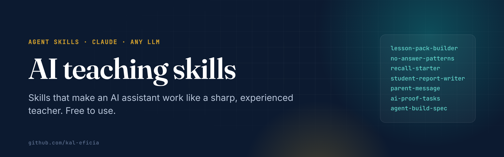

<p align="center"></p>

<p align="center">
  
  
  
</p>

Ask a general AI assistant for a lesson and you get a lesson plan. Ask for a quiz and the answers go A, B, C, D. Ask for reports and all thirty sound the same.

These skills fix that. Each one is a short, opinionated playbook, written by a working teacher, that tells an AI assistant how this job is done well: what to ask, what to build, and what to check before handing it over.

## The skills

| Skill | What it does |
|---|---|
| [**lesson-pack-builder**](skills/lesson-pack-builder/SKILL.md) | A full, teachable pack: teacher plan, interactive student page, homework, mark scheme and a one-screen solutions sheet |
| [**no-answer-patterns**](skills/no-answer-patterns/SKILL.md) | Checks and fixes MCQ and sort-task keys so students can't guess the pattern. Bundles a working checker script |
| [**recall-starter**](skills/recall-starter/SKILL.md) | A spaced, interleaved retrieval starter for the next lesson, built from what students got wrong |
| [**student-report-writer**](skills/student-report-writer/SKILL.md) | Reports that are honest, specific and kind, with different wording for every student |
| [**parent-message**](skills/parent-message/SKILL.md) | Short, plain-language messages to parents with one clear call to action |
| [**ai-proof-tasks**](skills/ai-proof-tasks/SKILL.md) | Redesigns homework and coursework so students still learn when AI is available |
| [**agent-build-spec**](skills/agent-build-spec/SKILL.md) | Turns an app idea into phase-gated prompts for Replit Agent, Claude Code or Cursor, UI first, with a stop gate after every phase |

## Install

**Claude Code**

```bash
git clone https://github.com/kal-eficia/ai-teaching-skills
mkdir -p ~/.claude/skills
cp -r ai-teaching-skills/skills/* ~/.claude/skills/
```

**Claude apps (claude.ai, desktop):** zip a skill folder (for example `skills/lesson-pack-builder`) and upload it under *Settings → Capabilities → Skills*.

**Any other assistant:** paste the contents of a `SKILL.md` at the start of the conversation, or add it to your project instructions. They are plain Markdown.

## Try it

> Use lesson-pack-builder. Year 10, Cambridge IGCSE Computer Science 0984, topic 3.1 the CPU, 50 minutes, remote. Last lesson was binary addition.

> Check this quiz for answer patterns and fix it. (paste or attach the quiz)

> Write end-of-term reports for these six students. Here are my notes on each. (paste notes)

## The principles behind them

- **Recall first.** Lessons open with retrieval from memory, spaced and interleaved.
- **Student pages talk to students.** Teacher notes stay in the teacher plan.
- **Make the work visible.** A summary after every page, confidence on every hinge question.
- **Students don't mark their own written answers.** The teacher sees them.
- **Check with code, not by eye.** Anything that can be verified (answer keys, word counts, numbering) is.
- **Make young people love AI, not fear it,** and design tasks so the learning still happens in their heads.

## Companion tools

- [pattern-guard](https://github.com/kal-eficia/pattern-guard): the answer-pattern checker as a CLI and library
- [recall-engine](https://github.com/kal-eficia/recall-engine): spaced-retrieval starters from a question bank and attempts log
- [lesson-page-kit](https://github.com/kal-eficia/lesson-page-kit): the student-page engine the lesson-pack skill can write for

## Contributing

Teachers: if a skill gets something wrong for your subject, country or age group, open an issue with an example. That is the most useful contribution there is.

---

Written by [Kalid Nur](https://github.com/kal-eficia), who teaches Computer Science, ICT and AI to 11 to 18 year olds and trains teams on adopting AI. MIT licence.
